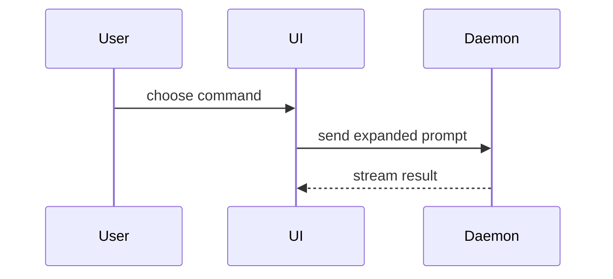

Help the user understand the current topic of conversation visually. Skip the preamble and keep prose brief. Pick the smallest view that makes the key point clear.

**The output is always one HTML file, never visuals printed in the terminal.** The views below are what goes *inside* the page: render code shapes as styled `<pre>` blocks, diffs with added and removed lines coloured, and Mermaid through the Mermaid JS module. The terminal gets only the file's path.

- Show logic or an algorithm as pseudocode:

```text
on(save)
  if content is unchanged
    return cached result
  write new content
  return fresh result
```

- Show runtime control flow as a call tree:

```text
submitForm
  createSession
    persistPrompt
    launchAgent
  navigateToSession
```

- Show UI structure as a component tree, including state and module boundaries that matter:

```tsx
<SessionPage> (apps/example/src/routes/session.tsx)
  useSessionEvents()
  <SessionToolbar>
    <RunSkillButton> (packages/ui)
```

- Show file responsibility or a broad refactor as a shallow file tree:

```text
src/
├── commands/       # parses user actions
├── sessions/       # owns session state
└── transport/      # sends API requests
```

- Show component interaction, control flow, or data flow with Mermaid:



- Use `diff` when the point is what changes and the surrounding shape already exists. Match the diff shape to the topic.

For a component change:

```diff
 <SessionPage>
   useSessionEvents()
   <SessionToolbar>
+    <RunSkillButton />
   <SessionTimeline>
+    <SkillResultCard />
```

For a file-layout change:

```diff
 src/
 ├── commands/
+│   └── show-me.ts       # expands the slash command
 ├── sessions/
-└── transport.ts
+└── transport/
+    ├── client.ts
+    └── stream.ts
```

For a call-tree or call-stack change:

```diff
 submitForm
   createSession
     persistPrompt
+    expandSkillMention
     launchAgent
-  navigateToSession
+  navigateToSession
+    subscribeToEvents
```

For a state or control-flow change:

```diff
 on(save)
-  write content
+  if content is unchanged
+    return cached result
+  write new content
+  invalidate cache
```

- Show the whole block when most of it is new, when omitted context would hide ownership or order, or when the user needs a copyable target shape:

```ts
function expandSkill(command: string): string {
  const skillName = command.slice(1)
  return `use the ${skillName} skill`
}
```

- For a visual UI, layout, state comparison, or concept too dense for Mermaid, draw it directly in the page — a diagram, an infographic, or a short slide deck, whichever fits the point. Match the product's colors, type, spacing, and components; use real labels and data.

### The file

Write one HTML file per invocation that supports desktop and mobile; inline its styles, and load
nothing but the Mermaid module from a CDN. Never save it in the repo or the working directory.
Name it `YYYY.MM.DD <letter> <Name>.html`: today's date, the next unused letter for that date and
name (`a`, then `b`), and a Title Case name.

Where it goes, and whether it opens, depends on the machine. `bin/show-me-place` asks the
`factory-machine` skill and decides:

- **HL** (the hub, with a display): the single show-me folder,
  `${SHOW_ME_DIR:-$HOME/Dropbox/remote-work/show-me}`. Once the file is written, open it in the
  default browser; this step is not optional on HL.
- **A peer** (LMF, OL; no display): `$EXCHANGE_ROOT/to-hl/artifacts/<plane>/show-me/`. No browser
  call. `new` prints a second line, the path the page will have on HL; give the user both.
- **A refusal** (exit 2: no `machine.env`, a malformed one, an unknown or `hl-only` plane on a
  peer, no plane on a peer): stop. Nothing is saved. Show the one line it printed, and do not
  fall back to another folder or a browser call.

The plane is `SHOW_ME_PLANE` when set, else the `slug` in the nearest `.pm/config.json` above the
working directory.

```bash
P=""
for root in "$HOME/.agents/skills" "$HOME/.claude/skills" "$HOME/.codex/skills"; do
  [ -x "$root/show-me/bin/show-me-place" ] && { P="$root/show-me/bin/show-me-place"; break; }
done
[ -n "$P" ] || { echo "show-me-place not found; install the show-me skill" >&2; exit 2; }
OUT=$("$P" new "Session Event Flow") || exit   # exit 2: show its one line and stop
F=${OUT%%$'\n'*}   # line 1: the file here (it exists, empty); line 2 on a peer: the path on HL
# write the HTML to "$F" here
"$P" open "$F"     # opens it on HL only; on a peer it prints the HL path instead
```

Then print the file's full absolute path, and on a peer the HL path too. If the open fails on HL
(a sandbox refusal), say so in one line so the user knows to open the path by hand.

### guidance

Place each visual next to the short text it supports. Keep only the calls, files, props, states, and boundaries needed to answer the user's current question or the options to resolve the current discussion point.

You may use one of these, you may use several, it is unlikely you will use all of them. Use your judgement and don't overwhelm the user.
