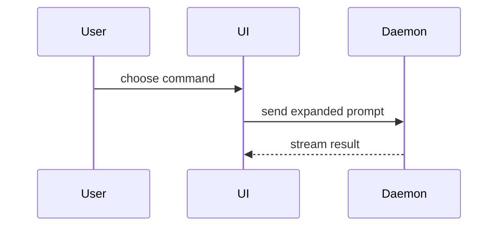

Help the user understand the current topic of conversation visually. Skip the preamble and keep prose brief. Pick the smallest view that makes the key point clear.

**The output is always one HTML file, never visuals printed in the terminal.** The views below are what goes *inside* the page: render code shapes as styled `<pre>` blocks, diffs with added and removed lines coloured, and Mermaid through the Mermaid JS module. The terminal gets only the file's path.

- Show logic or an algorithm as pseudocode:

```text
on(save)
  if content is unchanged
    return cached result
  write new content
  return fresh result
```

- Show runtime control flow as a call tree:

```text
submitForm
  createSession
    persistPrompt
    launchAgent
  navigateToSession
```

- Show UI structure as a component tree, including state and module boundaries that matter:

```tsx
<SessionPage> (apps/example/src/routes/session.tsx)
  useSessionEvents()
  <SessionToolbar>
    <RunSkillButton> (packages/ui)
```

- Show file responsibility or a broad refactor as a shallow file tree:

```text
src/
├── commands/       # parses user actions
├── sessions/       # owns session state
└── transport/      # sends API requests
```

- Show component interaction, control flow, or data flow with Mermaid:



- Use `diff` when the point is what changes and the surrounding shape already exists. Match the diff shape to the topic.

For a component change:

```diff
 <SessionPage>
   useSessionEvents()
   <SessionToolbar>
+    <RunSkillButton />
   <SessionTimeline>
+    <SkillResultCard />
```

For a file-layout change:

```diff
 src/
 ├── commands/
+│   └── show-me.ts       # expands the slash command
 ├── sessions/
-└── transport.ts
+└── transport/
+    ├── client.ts
+    └── stream.ts
```

For a call-tree or call-stack change:

```diff
 submitForm
   createSession
     persistPrompt
+    expandSkillMention
     launchAgent
-  navigateToSession
+  navigateToSession
+    subscribeToEvents
```

For a state or control-flow change:

```diff
 on(save)
-  write content
+  if content is unchanged
+    return cached result
+  write new content
+  invalidate cache
```

- Show the whole block when most of it is new, when omitted context would hide ownership or order, or when the user needs a copyable target shape:

```ts
function expandSkill(command: string): string {
  const skillName = command.slice(1)
  return `use the ${skillName} skill`
}
```

- For a visual UI, layout, state comparison, or concept too dense for Mermaid, draw it directly in the page — a diagram, an infographic, or a short slide deck, whichever fits the point. Match the product's colors, type, spacing, and components; use real labels and data.

### The file

Write one HTML file per invocation that supports desktop and mobile; inline its styles, and load nothing but the Mermaid module from a CDN. Save every one in a single folder, `${SHOW_ME_DIR:-$HOME/Dropbox/remote-work/show-me}`, never in the repo or the working directory. Name it `YYYY.MM.DD <letter> <Name>.html`: today's date, the next unused letter for that date and name (`a`, then `b`), and a Title Case name. Once the file is written, always open it in the default browser; this step is not optional:

```bash
DIR="${SHOW_ME_DIR:-$HOME/Dropbox/remote-work/show-me}"; mkdir -p "$DIR"
D=$(date +%Y.%m.%d); NAME="Session Event Flow"
F=""   # noclobber creates the name atomically, so two runs never get the same letter
for L in a b c d e f g h i j k l m n o p q r s t u v w x y z; do
  ( set -C; : > "$DIR/$D $L $NAME.html" ) 2>/dev/null && { F="$DIR/$D $L $NAME.html"; break; }
done
[ -n "$F" ] || { echo "26 pages named $NAME today; pick another name" >&2; exit 1; }
# write the HTML to "$F" here (it exists, empty)
xdg-open "$F" 2>/dev/null || open "$F"
```

Then print the file's full absolute path. If the open command fails (no display, or a sandbox refusal), say so in one line so the user knows to open the path by hand.

### guidance

Place each visual next to the short text it supports. Keep only the calls, files, props, states, and boundaries needed to answer the user's current question or the options to resolve the current discussion point.

You may use one of these, you may use several, it is unlikely you will use all of them. Use your judgement and don't overwhelm the user.
